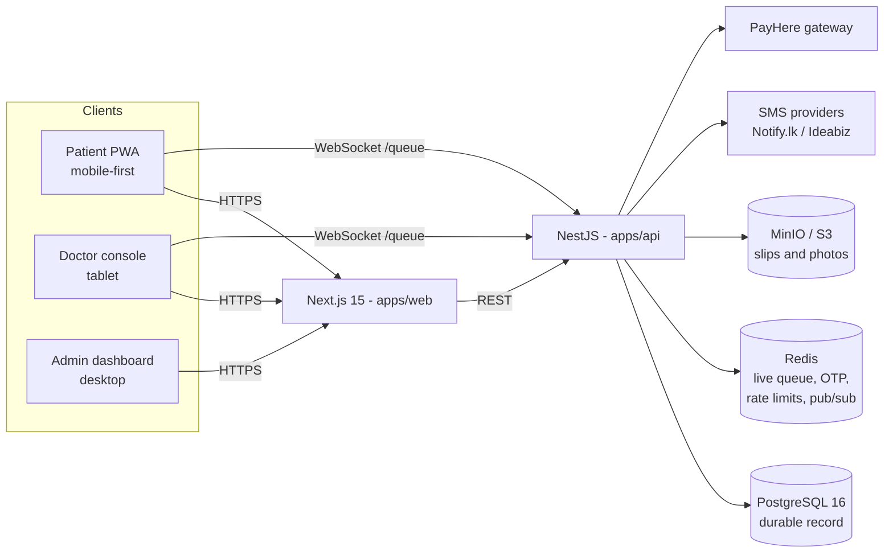

# MedQueue LK

Real-time patient queue and appointment platform for private dispensaries and channeling
doctors in Sri Lanka. Patients get a token, watch their live queue position, and arrive
just in time; doctors run their session from a live console; admins verify SLMC
registrations and approve payments.

## Architecture



## Repository layout

| Path | Purpose |
| --- | --- |
| `apps/web` | Next.js 15 (App Router, RSC), Tailwind v4, next-intl (si/ta/en) |
| `apps/api` | NestJS modular monolith + Socket.IO gateway |
| `packages/ui` | Bespoke design system (tokens, components, Storybook) |
| `packages/shared` | Zod schemas, LK districts, phone/currency helpers shared FE/BE |
| `docs/adr` | Architecture decision records |
| `deploy` | Deployment guides (VPS + Caddy, Vercel + Railway/Fly) |

## Local development

```bash
corepack enable                # pnpm
cp .env.example .env
docker compose up -d           # postgres, redis, minio, mailhog
pnpm install
pnpm --filter api prisma:migrate
pnpm --filter api seed
pnpm dev                       # web on :3000, api on :4000
```

Demo sign-ins after seeding (OTP prints in the api console with `SMS_PROVIDER=CONSOLE`):
admin `+94 77 000 0001`, doctors `+94 77 700 0001`–`0030`, patients `+94 77 100 0001`–`0040`.

## Quality gates

`pnpm lint && pnpm typecheck && pnpm test && pnpm build` — CI blocks merges on any
failure, then builds and Trivy-scans both Docker images.

## Observability & load

- `GET /healthz` (liveness), `GET /readyz` (Postgres + Redis), `GET /metrics`
  (Prometheus: HTTP histograms plus `queue_advances_total`, `queue_bookings_total`,
  `sessions_live`).
- Pino structured logs with `x-request-id` propagation; Sentry on both apps and
  OTLP tracing on the api activate when their env vars are set (see `.env.example`).
- `k6 run load/queue-watch.js` simulates 500 patients watching one live queue over
  Socket.IO — see the header of that file for required env vars.
